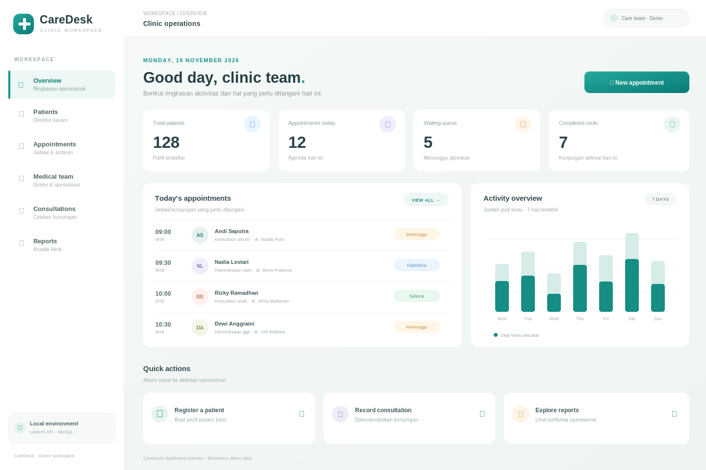

# CareDesk — Clinic Operations Workspace

CareDesk is a clinic operations demo built with **Laravel 10**, **Vue 3**, **Vite**, and **MySQL**. It provides a single-page workspace for managing patient profiles, appointments, medical staff, consultation notes, and operational reports.

## Dashboard Preview



> The image is an illustrative preview based on the application's actual dashboard layout. It uses fictional sample values and is not a screenshot of a live clinic system.

## Features

- **Overview dashboard** — patient count, today's appointments, waiting queue, completed visits, seven-day appointment activity, and recent consultation notes.
- **Patient directory** — search, register, edit, and export patient directory data as CSV; stores basic profile fields including date of birth, blood type, and allergies.
- **Appointments** — schedule visits, filter by date/status, update visit status, and remove appointments.
- **Medical team** — doctor directory, specialties, active status, and appointment/record counts.
- **Consultations** — document complaints, clinical notes/diagnosis, treatment, recommendations, basic measurements, and follow-up.
- **Reports** — monthly appointment totals, completion rate, daily trend, and popular services.
- **REST API** — Laravel endpoints consumed by the Vue frontend through Axios.

## Technology Stack

| Layer | Technology |
| --- | --- |
| Backend | PHP 8.1+, Laravel 10 |
| Frontend | Vue 3, JavaScript, Vite 5 |
| Styling | CSS, Tailwind/PostCSS toolchain |
| Database | MySQL / MariaDB |
| HTTP client | Axios |
| API package | Laravel Sanctum (installed; authentication is not yet applied to the clinic API routes) |

## Requirements

- PHP 8.1 or later, with Laravel-required extensions enabled (including `ctype`, `fileinfo`, `mbstring`, `openssl`, `PDO`, `tokenizer`, and `xml`).
- Composer 2.
- MySQL 8+ or a compatible MariaDB version.
- Node.js 18+ and npm.
- Git (optional, for cloning the repository).

For a Windows setup, XAMPP or Laragon can provide PHP and MySQL. Ensure the PHP CLI selected in CMD has the required extensions enabled; the PHP CLI version may differ from the one used by Apache.

## Installation on Windows (CMD)

1. Clone the repository and enter its folder:

   ```cmd
   git clone https://github.com/Arayandra/caredesk.git
   cd caredesk
   ```

   Or extract the project ZIP and open CMD in the project root (the folder containing `artisan`).

2. Create a MySQL database named `caredesk_db` using phpMyAdmin or the MySQL client.

3. Create the environment file:

   ```cmd
   copy .env.example .env
   ```

4. Install PHP dependencies:

   ```cmd
   composer install
   ```

5. Generate the Laravel application key:

   ```cmd
   php artisan key:generate
   ```

6. Check the database settings in `.env` (`DB_DATABASE`, `DB_USERNAME`, and `DB_PASSWORD`), then run migrations and fictional demo seeders:

   ```cmd
   php artisan migrate --seed
   ```

7. Install frontend dependencies and build the assets:

   ```cmd
   npm install
   npm run build
   ```

8. Start Laravel:

   ```cmd
   php artisan serve --port=8001
   ```

9. Open `http://127.0.0.1:8001` in your browser.

For frontend hot reload during development, use a second CMD window and run `npm run dev` instead of relying only on the production build. Keep that process running while using the app.

## API Endpoints

| Method | Endpoint | Purpose |
| --- | --- | --- |
| GET | `/api/dashboard` | Dashboard statistics and recent activity |
| GET, POST | `/api/pasiens` | List/search and create patients |
| GET, PUT, DELETE | `/api/pasiens/{id}` | Read, edit, and delete a patient |
| GET | `/api/doctors` | List doctors |
| GET, POST | `/api/appointments` | List and create appointments |
| PUT, DELETE | `/api/appointments/{id}` | Update and delete appointments |
| GET, POST | `/api/records` | List and create consultation records |
| GET | `/api/reports` | Operational report data |

## Demo Data

Run `php artisan migrate --seed` to load fictional doctors, patient profiles, appointments, and consultation notes. Seeder records are demonstration data only and are not real patient records.

## Security and Production Limitations

**This repository is a development/demo project and is not ready for production use with real patient information.** The current API routes do not enforce authentication or role-based access, even though Laravel Sanctum is included as a dependency. Anyone able to reach the API can potentially read or modify clinic records. Before deployment, implement and enforce authentication, authorization policies/roles, audit logging, secure backup/retention, HTTPS, rate limiting, and appropriate privacy controls. Do not expose this demo instance to the public internet or enter real patient data.

Other limitations to address before production include appointment collision checking on updates, validation that a consultation's linked patient/doctor match its appointment, and a review of patient deletion behavior because foreign-key cascades can remove associated records.

## Tests and Verification

The ZIP includes Laravel's example PHPUnit tests, but it does not yet include a comprehensive test suite for patient, appointment, consultation, and reporting workflows. Run the following commands after installing dependencies and configuring the database:

```cmd
php artisan test
php artisan route:list
php artisan migrate:fresh --seed
```

`migrate:fresh` drops all existing tables in the configured database. Use it only with a disposable development database.

---

Built as a clinic workflow demonstration with Laravel and Vue.
